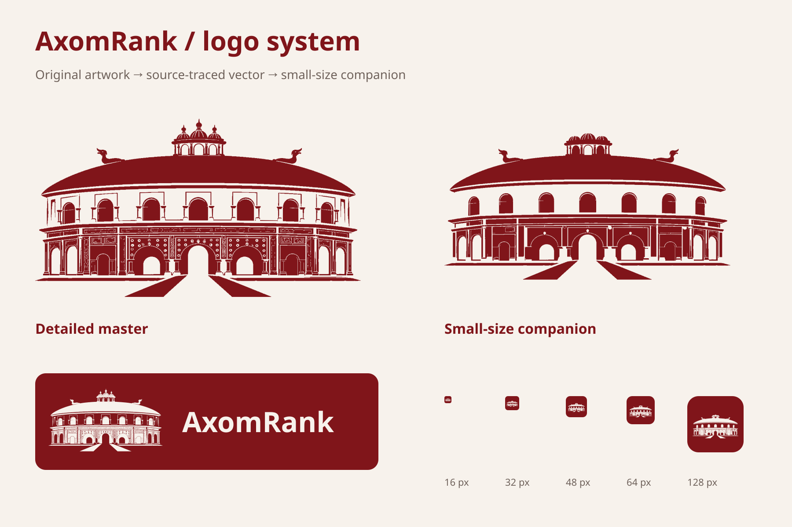
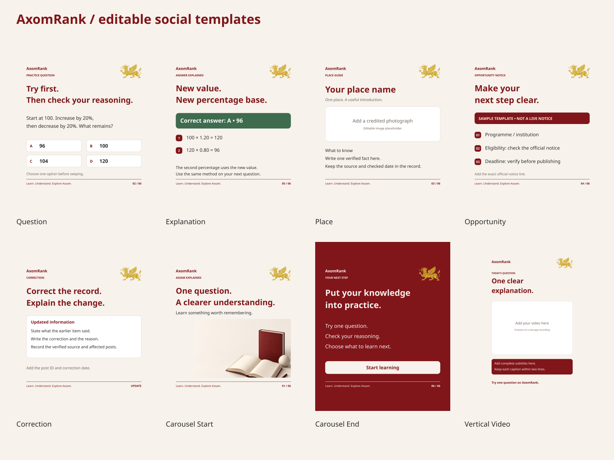

# AxomRank brand kit v1

A source-derived Rang Ghar logo family, editable wordmark lockups, reusable brand tokens and a bilingual social template system. Developed 11 October 2026. The original artwork is preserved alongside its trace provenance. This version is ready for owner review and design use; independent fluent Assamese editorial signoff is still pending.

## Open and use

- [Browse the kit](index.html) after downloading/unzipping it. GitHub displays HTML source; open the downloaded file in a browser for the gallery.
- [Detailed logo master](logo/svg/rang-ghar-master.svg), [small companion](logo/svg/rang-ghar-small-maroon.svg), [profile icon](logo/svg/profile-maroon.svg) and [favicon](logo/favicon/favicon-maroon.ico).
- [Editable wordmarks](wordmarks/svg/): horizontal, stacked and bilingual, each in maroon and reversed ivory. [Outlined versions](wordmarks/outlined/) keep the appearance without installed fonts.
- [Brand tokens](tokens/brand.tokens.json), [CSS variables](tokens/brand.css) and [editable visual system](tokens/visual-system.svg).
- [Editable social templates](templates/svg/) and [PNG previews](templates/png/).
- [Usage guide](docs/USAGE_GUIDE.md) and [QA record](docs/QA_REPORT.json).
- [Native illustration and complete generation prompt](illustrations/generation-record.json).

## Contents

| Family | Files and uses |
|---|---|
| Logo | Original JPEG, detailed editable vector, charcoal and reversed versions, transparent PNGs at 512/1024/2048 widths |
| Small-size exports | Simplified source-derived companion, profile variants, 16/32/48/64/128/256/512 favicon PNGs and multi-size ICO files |
| Wordmarks | Six editable SVG lockups, six outlined SVGs and six transparent PNGs |
| Tokens | Palette, Latin/Assamese type roles, spacing, margins, format sizes and an editable visual board |
| Social | Five teaching/information templates, carousel start/end and vertical video, each in English and Assamese; one additional Assamese long-copy test |
| Fonts | Four unmodified Noto font files and their licensing/provenance records |
| Native image | Reusable 3D learning illustration, preserved prompt and source record |

The main logo remains Rang Ghar. Social templates use the supplied gold winged insignia in accordance with the later carousel decisions. Neither motif is an official government emblem. No textile borders or gamosa framing are used.

All logo SVGs contain vector geometry, not an embedded raster disguised as a vector. Templates keep text live and layouts editable; the supplied insignia and generated learning illustration are embedded raster assets inside otherwise editable SVGs. Video media and place photography remain replaceable placeholders.

## Rebuild

With Python 3, NumPy, Pillow and Inkscape available, run `python3 brand-kit/v1/scripts/build_kit.py` then `python3 brand-kit/v1/scripts/export_kit.py` from the repository root. Install the bundled Noto fonts before recreating text exports. The build traces the preserved artwork; it does not call an image-generation API. The generated illustration is a committed input.

The original imported book/reference files remain unchanged. This kit does not constitute trademark registration, a new grant of rights to the supplied logo, or a completed Assamese editorial approval.
